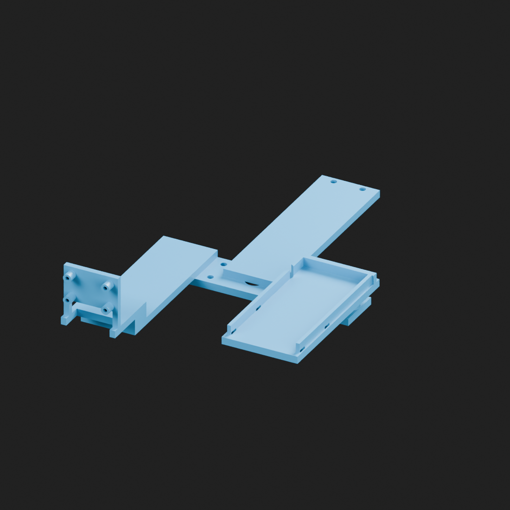

# Skygangsters — current owl CAD

Public CAD-only handoff, 29 September 2026. One current snapshot, not the original project's git history. Start here when continuing work with another assistant.

Documentation updated 30 September 2026. **The bundled CAD snapshot is still V2.2; the newer V3 gun-holder scripts/artifacts have not been packaged here yet.** The toolchain below distinguishes these two workspaces. Do not mistake documentation of V3 for availability in this checkout.

## Current status

- **Carrier V2.2 failed during PETG support removal and is withdrawn from printing.** Both pump-bed post joints and the long rear arm broke. Its retained files are reference only, despite passing digital checks.
- Current head/body shells remain **on hold**. Their latest geometry is included, but no shell print files are offered as a released print pack.
- The pump is the latest rounded photo-derived reference: measured housing/nozzle 132.25 × 32 × 24 mm, approximately 75 g; nominal 18 mm round front. Elbow/hose and local details are estimated.
- PETG coupon: middle option selected, 3.4 mm M3 clearance / 5.7 mm nut pocket across flats. Confirm nut does not spin when gently tightened. PTZ four-hole coupon passes: finger installation, no rocking/warp. Camera coupon still pending.
- User has **no cable ties**. A local V3 prototype now has an open-backed curved cradle, flat PTZ adapter and separate screw-retaining bridges. Only its small saddle coupon plus one bridge are next for PETG testing; results pending. Full mount, camera and shells remain held. V3 is not yet included in this snapshot.
- Pi 5 received, Raspberry Pi OS Lite 64-bit installed; Wi-Fi/SSH key login verified and OS packages updated. No reboot performed after updates. No camera/application/actuator setup done. Credentials/network identity are deliberately excluded.

## Open or print

| File | Purpose |
|---|---|
| [Bundled assembly](cad/latest/owl_current_review.step) | V2.2 layout reference; not the new compact V3 layout |
| [Bundled head assembly](cad/latest/head_current_review.step) | V2.2 head, local mounting plane Z=0; not a print release |
| [Withdrawn carrier STL](print/carrier/head_payload_carrier_v2_2.stl) | Failed V2.2 physical prototype; do not reprint |
| [Historical carrier print guide](docs/CARRIER_PRINT.md) | Superseded V2.2 instructions, not current print advice |
| [BOM](BOM.md) | Hardware/materials, procurement and open decisions |
| [Devlog](Devlog.md) | Concise CAD-relevant decisions and evidence |
| [Wiring plan](docs/WIRING_PLAN.md) | Proposed topology, not an energized wiring release |



STL print units are mm. The previous support-heavy V2.2 slice is withdrawn following physical failure. For the local V3 coupon and one bridge only: supplied print orientations, PETG, 0.20 mm, five perimeters, 25% infill, 2 mm brim, **supports OFF**; separate-slice estimates total about 36 minutes / 11.13 g. STEP assembly coordinates are not bed orientations. Purchased electronics, PTZ and pump references must not be printed.

## Software and setup on another laptop

These are the versions actually used, not a claim that they are the newest. Geometry generation, rendering and slicing are separate steps; you do not need every application just to print an STL.

| Software | Verified version / role | Needed for |
|---|---|---|
| Python | 3.12.8 | Running CAD and validation scripts |
| CadQuery (OpenCascade-based CAD kernel) | 2.7.0 | Parametric solids, booleans, fillets, STEP/BREP/STL export |
| trimesh | 4.12.2 | Mesh bounds, connected components, watertightness, winding and print placement |
| NumPy | 2.4.6 | Numeric geometry/transform checks |
| Blender | 4.2.3 LTS | Actual CAD-mesh previews, materials, lighting and cameras; optional for CAD building |
| PrusaSlicer | 2.9.3 | Slicing, support/toolpath inspection and diagnostic time/material estimates |
| Fusion | User's CAD viewer/editor; version not recorded | Optional STEP inspection/measurement; not required by the Python build |
| Git | Version not pinned | Clone and track the handoff; GitHub CLI is not required to use it |

Install Python 3.12 and Git on the new laptop. Install Blender and PrusaSlicer separately if rendering/slicing is needed. `requirements.txt` installs the three pinned Python packages and their dependencies; it does **not** install desktop applications. Do not copy a virtual environment between computers or operating systems—recreate it.

From a terminal, clone the handoff and set up its Python environment:

```sh
git clone https://github.com/Hsgngr/skygangsters-cad.git
cd skygangsters-cad
# macOS / Linux: confirm this interpreter is Python 3.12 first
python3 --version
python3 -m venv .venv
.venv/bin/python -m pip install -r requirements.txt
.venv/bin/python -c "import cadquery, trimesh, numpy; print(cadquery.__version__, trimesh.__version__, numpy.__version__)"
```

On Windows PowerShell, use `py -3.12 -m venv .venv`, then replace `.venv/bin/python` with `.venv\Scripts\python.exe` in the commands. Cross-platform setup has not been exercised here; the verified build machine is macOS. If a pinned dependency has no wheel for the chosen interpreter/platform, resolve that explicitly rather than silently upgrading the CAD stack and assuming identical geometry.

### Script and function map

Paths in this table are relative to the **public handoff root** and exist in this checkout:

| Script / function | Purpose |
|---|---|
| `cad/rebuild.py check` / `check()` | Rebuild/check the bundled V2.2 geometry, STL hash/mesh, neutral intersections and nine sampled poses. A pass does not reinstate the withdrawn physical print |
| `cad/rebuild.py carrier` / `carrier()` | Generate a V2.2-derived candidate; not the V3 mount |
| `cad/rebuild.py pump` / `pump()` | Generate the rounded purchased-pump reference STEP, not a printable pump |
| `cad/rebuild.py shells` / `shells()` | Generate candidate shells; does not refit purchased references or approve printing |
| `cad/build_v2.py` | Shared primitives (`box`, `cyl`, `ellipsoid`, `loft`, `hole`, `nut`) and `body()`, `head()`, `make_head_carrier()` |
| `cad/build_pump_photo_reference.py` / `build_parts()` | Photo-derived pump solids, with estimated local details around measured overall dimensions |
| `cad/geometry_checks.py` / `intersection()`, `pose()`, `point()`, `bounds()` | Interference volumes, pan/tilt transforms and bounds |
| `cad/inventory.py` | Check tracked handoff file hashes; `--write` refreshes the inventory after intentional reviewed changes |

The **original working repo** uses `.venv-cad` and `cad/owl/`, not this handoff's `.venv` and `cad/`. Its newer V3 workflow is recorded here for transfer, but these files are **not yet included in this checkout**:

| Local V3 file / function | Purpose |
|---|---|
| `cad/owl/gun_mount_v3.json` | Editable dimensions and provisional fit assumptions |
| `cad/owl/build_gun_mount_v3.py` | `make_adapter()`, `make_bed()`, `make_retainer(y)`, then `main()` builds/exports the assembly, coupon, print meshes and validation report |
| `cad/owl/slice_gun_mount_v3.py` | Runs diagnostic PETG slices through `slice_v2.run()`, checks STL hashes and absence of support toolpaths; never sends a printer job |
| `cad/owl/render_gun_mount_v3.py` | Blender script; `mat()` and `render()` create colored CAD previews from `scene.json` and meshes |
| `cad/owl/GUN_MOUNT_V3_REVIEW.md` | Physical test sequence, fasteners, orientation and remaining uncertainties |

Once the complete V3 source/dependency/reference bundle is transferred, its current **original-repo/macOS** commands are:

```sh
.venv-cad/bin/python cad/owl/build_gun_mount_v3.py
.venv-cad/bin/python cad/owl/slice_gun_mount_v3.py
"/Applications/Blender.app/Contents/MacOS/Blender" --background --python cad/owl/render_gun_mount_v3.py
```

Do not run those commands in a public-only clone: the files are absent. V3 also needs the shared CAD/pump modules, their JSON inputs, geometry-check helpers, purchased PTZ BReps and `slice_v2.py`; copying only its main script is insufficient. Build before slicing/rendering. Output is `cad/owl/generated/gun_mount_v3/`; regeneration overwrites that output folder's matching files, so preserve physical-test artifacts before changing parameters. Blender runs its script with its own Python/`bpy`, not the CAD virtual environment. These previews are renders of the CAD geometry, not AI-generated concept images.

### Slicer and portability details

The original slicer helper currently hardcodes `/Applications/PrusaSlicer.app/Contents/MacOS/PrusaSlicer`; the V3 slicer uses a macOS temporary directory for diagnostic logs/G-code. On Windows/Linux, adapt the executable and temporary-directory paths before running. The Blender command above is likewise Mac-specific; use the installed Blender executable on the other laptop. Only standard application locations and repository-relative paths are documented here; personal home/workspace paths are omitted.

Install/select these exact PrusaSlicer presets to reproduce the diagnostic slices: `Original Prusa MK4S HF0.4 nozzle`, `0.20mm STRUCTURAL @MK4S 0.4`, `Generic PETG @MK4S HF0.4`. A fresh installation may not have them enabled. The printer/nozzle/material must match the real machine; do not send diagnostic G-code to a different printer. Inspect the layer preview for bridging, supports, first-layer contact and accessible fastener holes before printing. Re-run fit coupons when changing material or printer.

### File formats and what to open

| File | Use |
|---|---|
| `*_print.stl` | Slicer input, millimetres, already placed/oriented for printing; STL itself carries no reliable unit metadata or CAD parameters |
| `*_assembly.stl` | Mesh at its assembly position; not a prepared print orientation |
| `.step` | CAD exchange for Fusion or another STEP-capable viewer; solids/assemblies, not the original parametric feature history |
| `.brep` | OpenCascade working solids used by the scripts; normally no need to open manually |
| `.py` + dimension `.json` | Editable parametric source; modify these and rebuild instead of sculpting the STL |
| `scene.json` | Mesh placement/material manifest for rendering, not a dimension configuration |
| `validation.json`, `slicer_validation.json` | Digital check results only, not proof of physical strength or hardware fit |
| `.png` | Preview image only |
| `.gcode` | Printer-specific toolpaths generated by slicing; not portable CAD source |

Normal workflow: edit parameters → build → inspect validation and STEP → slice the designated print STL → inspect toolpaths → small physical fit test → record feedback. Camera/whole-shell release and powered testing are separate gates.

## Editable CAD and reproducibility

`cad/latest/components/` contains one current world-space BRep per component; `manifest.json` identifies print/reference/reserve parts. Current body and shells retain their prior revision because they have not changed; superseded carriers, rectangular pumps, scans and concepts are not included.

`cad/build_v2.py` contains the current body/head shape functions, `cad/build_pump_photo_reference.py` the rounded pump shape functions. Historical full-build/export entry points have been removed for the handoff. JSON files beside them are editable dimensions. Some procurement/status metadata in these original engineering parameters is historical; **this README and BOM are authoritative for current status**. Changing dimensions is not physical validation.

```sh
python3 -m venv .venv
.venv/bin/pip install -r requirements.txt
.venv/bin/python cad/rebuild.py check
.venv/bin/python cad/rebuild.py carrier
.venv/bin/python cad/rebuild.py pump
```

`check` compares regenerated carrier geometry with the published BRep, checks the released mesh/hash and rechecks carrier clearances. `carrier` and `pump` write **unreleased candidates** into ignored `cad/candidates/`; they do not overwrite published files. Use `shells` only for deliberate head/body redevelopment. Purchased reference geometry is a saved snapshot and is not automatically resized/repositioned when parameters change. Revalidate and re-slice before approving any changed print.

Original carrier audit reports in `validation/` preserve the 34 checks and nine sampled poses from the local release. Their source hashes identify the original scripts before this packaging refactor, not the extracted source modules here. The exported carrier STL is byte-identical to that release. The combined review assembly is a packaging update, not new full-assembly clearance or print certification. `SHA256SUMS.json` inventories the initial handoff (regenerate after future edits).

## Next work / constraints

1. Await the V3 saddle coupon and one bridge physical result; do not reprint the withdrawn V2.2 carrier or operate the broken assembly.
2. Check real casing contact, open rear wire access, external hose clearance, padding gaps, axial grip and screw engagement before the full V3 mount. Transfer/review the V3 bundle before continuing its CAD work on another laptop.
3. Test camera coupon before installing the PCB. Then verify carrier/payload fit, cable access, head-shell removal and motion clearance before any shell print.
4. Measure ESP32 DevKit V1 board, underside pins, four hole centres and micro-USB plug clearance. Left body `controller` reserve is only 32 × 58 × 18 mm; not a proven board fit. Right `pump_interface` is likewise a placeholder, not a selected driver.
5. Bottle remains parametric nominal 500 ml: provisional 90 mm diameter × 110 mm height, not a verified bottle. Water stays low in the fixed body; removable bottom is for servicing, not removal of the structural chassis.
6. Engineer wet/dry separation, fixed rear power inlet, Pi protection/cooling, fuses/regulators, hose and ribbon service loops. Head/body remain independent modules referenced to the purchased PTZ.
7. No powered actuator tests until rated supplies, current budget, signal compatibility, travel limits, deliberate arming, pump timeout and fail-OFF behavior are established. Use only low-pressure humane deterrence; exclude people, pets and unsafe spray areas.

The unused partially covered Ø10 mm crossbar hole remains in the bundled withdrawn V2.2 carrier. The local V3 adapter removes it. Cosmetic eyebrows/wings are deferred.

## Sources and publishing scope

- Purchased Yahboom PTZ geometry is derived from [YahboomTechnology/2DOF-PTZ](https://github.com/YahboomTechnology/2DOF-PTZ), commit `77a32cbb338fb1bf03d1c98dba7d7cf1c637fdc2`, `5.3D Model file/2DOF PTZ.STEP`. No explicit redistribution license was identified; no project license is asserted over manufacturer geometry.
- Pi reference derives from Raspberry Pi's official Pi 5 STEP; retained major solids only. See [manufacturer drawings](https://www.raspberrypi.com/documentation/computers/raspberry-pi.html#schematics-and-mechanical-drawings) and included [MIT notice](THIRD_PARTY_RASPBERRY_PI_LICENSE.txt).
- Camera proxy uses the [Module 3 Standard mechanical drawing](https://datasheets.raspberrypi.com/camera/camera-module-3-standard-mechanical-drawing.pdf). It is inverted about its optical axis for ribbon access; image rotation will be needed.
- No original photos/scans, recordings, software firmware, model datasets/weights, secrets, private Obsidian notes, network configuration or old git history are included. No new blanket open-source license has been chosen.
- Older local work lives outside this public snapshot in the original workspace's ignored `old_work/`. Do not add it here or copy private project data into this repo. Use company tools only as permitted by your employer; a public repo does not override those rules.
