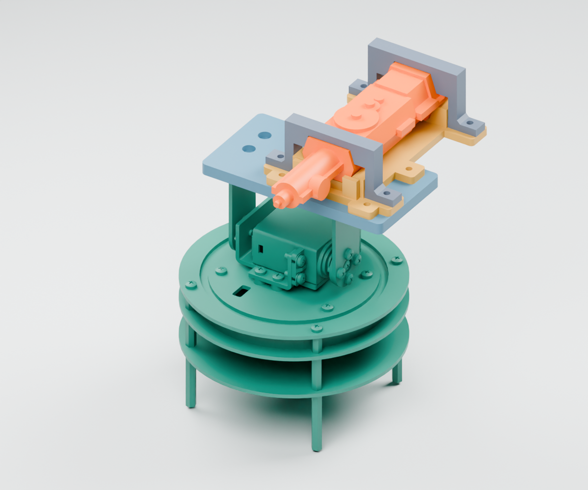

# Skygangsters — owl CAD handoff

Updated 30 September 2026. Public CAD-only handoff. **V4 is an unpowered fit prototype; physical results are pending.** Only the current carrier is supplied. Older carrier artifacts are removed from the current tree, not from Git history.

## Current layout and print files

The user's pump STEP now defines the contact profiles. The gun stays **32 mm to the right of the PTZ centre**, leaving room on the left for a future camera bracket. Only its **front-to-back length midpoint** is centred over the PTZ mounting pattern; this is not a measured centre-of-mass claim.

- [V4 review assembly](cad/latest/carrier_v4/assembly/carrier_v4_review.step): pump, carrier and purchased PTZ, not a print file.
- [Print-oriented STLs](print/carrier/): six files, including two small fit saddles.
- [Print order, settings and fasteners](docs/CARRIER_PRINT.md).
- [BOM](BOM.md), [Devlog](Devlog.md), [proposed wiring](docs/WIRING_PLAN.md).
- [CAD checks](validation/carrier_validation.json) and [diagnostic slices](validation/carrier_slicer_validation.json).



Start with **rear fit saddle + rear bridge**, then **front fit saddle + front bridge**. After both fit, print the adapter and deck; reuse the V4 bridges. Standalone saddles are test coupons, not extra parts to place on the deck.

PETG, supplied print orientation, 0.20 mm, five perimeters, 25% infill, 2 mm brim, **supports OFF**. Estimates use Prusa MK4S HF0.4 profiles; inspect your own slice. No printer G-code is supplied or sent.

V4 has 104 passing digital checks and six single-solid, watertight print meshes. These do not prove physical fit, layer strength, hose routing or safe powered operation. The body/head baseline is retained for redevelopment only. **Camera bracket and shell attachment are not included in V4. Do not print the old shells.**

## Software and a new laptop

Verified development versions, not claims about the newest releases:

| Software | Version | Purpose |
|---|---|---|
| Python | 3.12.8 | CAD scripts |
| CadQuery / OpenCascade | CadQuery 2.7.0 | Solids, sections, booleans and exports |
| trimesh | 4.12.2 | Print orientation and mesh validation |
| NumPy | 2.4.6 | Numeric geometry checks |
| Blender | 4.2.3 LTS | Optional actual-CAD previews |
| PrusaSlicer | 2.9.3 | Optional diagnostic slices |
| Fusion | Not recorded | Optional STEP viewing/editing |
| Git | Not pinned | Clone and track this handoff |

Install Python 3.12 and Git; install desktop applications separately if needed. Do not copy a virtual environment between machines.

```sh
git clone https://github.com/Hsgngr/skygangsters-cad.git
cd skygangsters-cad
python3 -m venv .venv
.venv/bin/python -m pip install -r requirements.txt
.venv/bin/python cad/inventory.py
.venv/bin/python cad/rebuild.py check
```

On Windows use `py -3.12 -m venv .venv` and replace `.venv/bin/python` with `.venv\Scripts\python.exe`. macOS is the verified platform; other platforms have not been tested. Resolve missing dependency wheels explicitly rather than silently upgrading the CAD stack.

## Scripts and functions

| Script / function | Purpose |
|---|---|
| `cad/rebuild.py check` | Rebuild V4, run geometry checks, compare six released BReps and validate published STL hashes/meshes |
| `cad/rebuild.py carrier` | Build V4 candidates without overwriting published files |
| `cad/build_carrier_v4.py`: `section_cutter()`, `placed()` | Extract/offset actual pump sections; map native axes into carrier coordinates |
| Same: `adapter()`, `saddle()`, `bridge()`, `deck()`, `main()` | Construct, export and check the carrier and small fit tests |
| `cad/pump_reference.py`: `load_reference()` | Verify pinned source STEP hash and solid validity; never rescale the source |
| `cad/rebuild.py pump` | Inspect/export the purchased pump reference, not a printable pump |
| `cad/geometry_checks.py`: `intersection()`, `pose()`, `bounds()` | Solid interference, pan/tilt transforms and bounds |
| `cad/build_v2.py` | Shared `cyl()`, `nut()` and retained baseline `body()` / `head()` functions; old carrier function removed |
| `cad/rebuild.py shells` | Held baseline shell candidates, not redesigned around V4 |
| `cad/slice_carrier_v4.py` + `slicer_support.run()` | Diagnostic slices and support-toolpath/hash checks; no printer connection |
| `cad/render_carrier_v4.py`: `mat()`, `render()` | Blender renders from generated scene meshes; not AI concept images |
| `cad/inventory.py` | Check tracked file inventory; `--write` refreshes after intentional reviewed changes |

Dimensions are in `cad/carrier_v4.json` and shared interface JSON files. Source identity is pinned in `cad/pump_reference.json`. The user STEP is included; native Fusion archives and private reference photos are not included.

Generated candidates go to ignored `cad/candidates/`. Build before rendering or slicing:

```sh
.venv/bin/python cad/rebuild.py carrier
.venv/bin/python cad/slice_carrier_v4.py
blender --background --python cad/render_carrier_v4.py
```

Use your installed Blender executable if it is not on PATH. Blender supplies its own Python/bpy; do not run that script with the CAD virtual environment.

PrusaSlicer is found on PATH or its standard macOS application location; otherwise set `PRUSA_SLICER` to its executable. Enable these presets: `Original Prusa MK4S HF0.4 nozzle`, `0.20mm STRUCTURAL @MK4S 0.4`, `Generic PETG @MK4S HF0.4`. Raw diagnostic logs/G-code stay in a temporary directory; reports contain filenames only. Inspect settings and layer previews for the actual printer.

## Formats and coordinates

- `print/carrier/*_print.stl`: millimetres, bed-oriented slicer inputs.
- `cad/latest/carrier_v4/assembly/`: STEP/BREP and assembly-position meshes. Even a one-object assembly STL is **not** in print orientation.
- `cad/references/water_pump/water_pump.step`: authoritative user model, unmodified and without the omitted fillets/chamfers.
- `cad/latest/components/` and `manifest.json`: retained body/head/hardware baseline in world coordinates, held pending V4 integration.
- `.py` + dimension `.json`: editable parametric source; STEP has solids, not Fusion feature history.
- `scene.json` (generated): mesh/material list for renders, not dimension configuration.
- `SHA256SUMS.json`: public tracked-file inventory excluding itself.

V4 assembly coordinates put Z=0 at the PTZ top mounting face. Source mapping is `(x,y,z) → (32+x,66.05-z,12.4+y)` mm. Nozzle points toward negative assembly Y. Do not combine retained world-coordinate shell BReps with local carrier parts without the correct transform and new interference checks.

## Next gates

1. Record rear/front physical fit results, including contact, rocking, clip clearance and wire/hose access.
2. Assemble the four-part carrier with verified screw engagement, no power connected.
3. Fit the camera and design its left-side bracket plus independent head-shell attachments.
4. Resize the head around the actual payload and PTZ motion envelope; check full shell, cable and hose clearances.
5. Resolve power conversion, motor driver, current budget and fail-safe controls separately.

No credentials, private machine paths, network settings, datasets or firmware are included. Wiring is a proposal, not approval to energize hardware.
