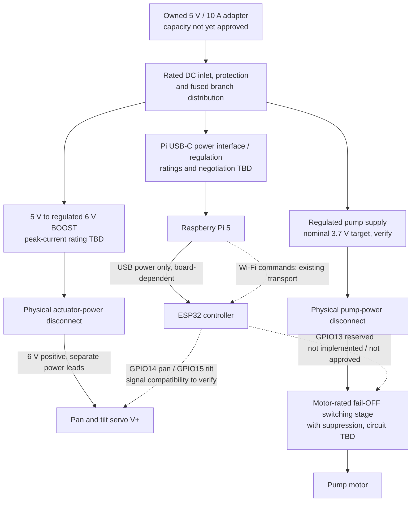

# ESP32, servos and power — connection plan

2026-09-29. **Proposed topology, not a ready-to-energize wiring release.** No board was powered, firmware flashed or motor commanded. Component ratings, board power-path details and servo signal compatibility remain to be verified. GPIO labels below are ESP32 GPIO numbers, not physical header positions.

## Selected controller — physical board identified

User confirms the back says **ESP32 DEVKIT V1**. Front photo (private reference photo, not published) shows an **ESP-WROOM-32 module**, micro-USB socket, 30 header pins, four corner mounting holes and EN/BOOT buttons. This is the intended controller, not the previously recorded ESP32-CAM. Exact manufacturer/revision, USB-UART chip and power-path circuit are not established by these markings.

Visible D14 and D15 labels correspond to the current firmware's GPIO14 pan / GPIO15 tilt mapping; the GPIO15 boot-strapping caveat below still applies. The generic `servo-test` firmware target is the relevant existing starting point, not the camera-enabled target; its startup and motion behavior still need revision before loaded tests. No firmware or pin allocation changed.

Measure PCB length/width, total height including underside pins, mounting-hole diameters and centre spacing before replacing the generic CAD reserve. Include micro-USB plug/cable access. Controller mounting is in the fixed body and does not change the released V2.2 head carrier; no body fit approval follows from identifying the board.

## Where the ESP32 is in the CAD

Looking at the owl from the front, in the stationary body beside the bottle and below the Pi:

| CAD name | Front-view location | Reserved envelope | Meaning |
|---|---|---|---|
| `controller` | Left, centre XYZ = (-73, 0, 49) mm | 32 × 58 × 18 mm | ESP32/controller placeholder; not an exact board model |
| `pump_interface` | Right, centre XYZ = (73, 0, 49) mm | 32 × 58 × 18 mm | Pump switch/interface placeholder; not a selected relay or regulator |
| `controller_strap_tray_-1` / `_1` | Below those two reserves | Main plate 34 × 68 × 3 mm, plus mounting arms | Generic printed strap trays; real board holes, insulating spacers and connector clearance unfinished |

The purple left block is the controller reserve; the pink-purple right block is the pump interface. Neither is a servo driver. The blue platforms **in the head** instead support the camera and pump; the ESP32 stays stationary in the body.

These reservations are not a completed dry compartment. Their position beside the water reservoir needs a splash barrier, drainage separation, USB access and mounting verification. Do not print the body yet. Converters, fuse holders, disconnect and power-distribution hardware have not been fitted into these two boxes; do not assume everything will fit there.

## One-adapter architecture

This diagram follows the preference to reuse one external adapter if its measured capacity permits. The present YU0510 is **5 V / 10 A**, not a 6 V servo supply. Its indoor-only mains adapter remains indoors; only isolated low-voltage DC enters the owl through a future fixed rear inlet.

Solid arrows are positive power paths; dashed arrows are command/signal paths. **Returns are omitted from this overview, not optional:** for the proposed non-isolated converters, join output negatives, ESP32 GND and servo returns at the DC distribution/common-reference arrangement. Each motor return goes back on its own adequately rated lead, not through an ESP32/Pi ground pin or PCB trace. Pi/ESP32 ground is also linked by USB; check the complete return arrangement for unwanted motor-current paths. Do not tie different positive rails together.

USB power for the ESP32 is a proposal conditional on its actual board/interface; current code receives commands over Wi-Fi, **not a USB serial command protocol**. Do not connect both USB power and a separate ESP32 5 V/VIN feed unless that exact board's power-path circuit supports it. The optional higher-voltage single-adapter architecture in `BOM.md` remains an alternative if this 5 V topology fails its budget; no converter or replacement supply has been selected.

## Servo connections — current source-code mapping

Both existing firmware targets use the same mapping (`esp32_related/firmware/src/main.cpp` and `main_servo_test.cpp`). Neither mapping is proof of compatibility with a particular physical board or servo.

| From | To | Status / precaution |
|---|---|---|
| ESP32 **GPIO14** | Pan servo **signal** | Current code; verify header label and 3.3 V signal acceptance |
| ESP32 **GPIO15** | Tilt servo **signal** | Current code; classic ESP32 GPIO15 is a boot-strapping pin, so connected circuitry must not force an incompatible reset level |
| Regulated servo **+6 V**, through branch protection/disconnect | Both servo **V+**, in parallel with separate leads | Provisional voltage is within their marked DC 6–7.4 V range; converter peak current unselected |
| Servo-supply **0 V** | Both servo **GND**, each with its own return | Do not return motor current through the ESP32 |
| ESP32 **GND** | Servo-supply **0 V** common reference | Needed for a non-isolated PWM signal path |
| Pi USB port | ESP32's verified USB input | Board-dependent power option; not servo power, and does not implement USB control |

Servo photos show yellow/red/brown wiring, consistent with signal/V+/GND, but confirm the manufacturer's connector order before mating. Never rely on a connector's orientation or wire color alone. If 3.3 V PWM is insufficient, add an appropriate one-way buffer/level translator; do not put the 6 V rail on a GPIO or choose a buffer before checking thresholds and startup behavior.

**No PCA9685 board is required by default.** ESP32 hardware PWM generates the two control signals; each hobby servo already contains its motor control electronics. A PCA9685 generates signals, it is not a servo power supply and cannot solve the 5 V versus 6–7.4 V mismatch. Espressif documents LEDC-based multi-servo control: [servo component](https://docs.espressif.com/projects/esp-iot-solution/en/latest/motor/servo.html).

## Pump branch — still requires circuit identification

- GPIO13 is reserved in the historical README, not implemented as a functioning pump output in the inspected firmware. It must control a **verified 3.3 V-compatible interface**, not connect to the pump button/motor power wires.
- Existing low-trigger relay modules are candidates only: identify their input circuit, supply and motor-contact rating first. A relay option would normally use the verified normally-open contact path for default OFF. A motor-rated MOSFET stage is an alternative, not a second required board.
- Final motor-terminal wiring depends on the actual switch circuit and driver. Provide flyback/transient protection appropriate to that circuit and startup/run current; a relay's coil diode alone is not motor suppression. No schematic-level component values or terminal assignment are approved here.
- The original 3.7 V Li-ion battery label establishes a nominal source, not pump startup current. Do not connect 5 V/6 V directly, charge the cell from a plain regulator, or parallel the battery with the new supply. Battery and powered pump testing are outside this wiring-plan step.

## What remains before wiring / purchasing converters

1. **ESP32 dimensions and circuit:** intended board now identified as DEVKIT V1 / ESP-WROOM-32 with micro-USB. Need board length/width/height including headers, mounting-hole diameter/spacing and connector access; rear photo/manufacturer documentation would help establish the power path. Historical USB-C ESP32-CAM stock is not the selected controller. Do not assume a universal DevKit V1 outline.
2. **Servo electrical data:** exact model documentation, peak-current demand and 3.3 V PWM compatibility. GPIO15 reset behavior still needs review; the selected plain dev board does not use the old ESP32-CAM camera/SD peripherals.
3. **Power components:** converter continuous/peak and transient ratings, connectors, terminals, wire sizes, branch fuses/disconnects, cooling and capacitor/filter requirements. The removable barrel adapter is not known to carry 10 A. A buck converter such as the recorded MP1584 cannot boost 5 V to 6 V.
4. **Pi input:** a rated USB-C interface and adequate voltage at the Pi. The 5 V/10 A label alone does not establish USB-PD 5 A capability. The official Pi supply remains a useful temporary bench source. [Raspberry Pi power documentation](https://www.raspberrypi.com/documentation/computers/raspberry-pi.html#power-supply).
5. **Firmware fail-safe revision:** no pump endpoint/watchdog exists in the inspected source; both targets immediately command centre on startup and accept a generic 0–180 range. That is not calibrated to this loaded mechanism. Require deliberate arming, calibrated limits, command timeout/pump-OFF behavior and safe reset before powered assembly tests. No firmware was altered here.
6. **CAD integration:** board-specific mounts/USB clearance, regulators, fuse/distribution mounts and physical disable access; fixed rear power entry; separate return wiring and controlled moving loops. Current carrier is for dry fit, not electrical commissioning.

Sources for board caveats: [Espressif GPIO restrictions, including GPIO15](https://docs.espressif.com/projects/esp-idf/en/stable/esp32/api-reference/peripherals/gpio.html); [DevKitC power options](https://docs.espressif.com/projects/esp-dev-kits/en/latest/esp32/esp32-devkitc/user_guide.html). DevKitC documentation illustrates the single-power-input rule; it is not a schematic for the user's DEVKIT V1 board.
